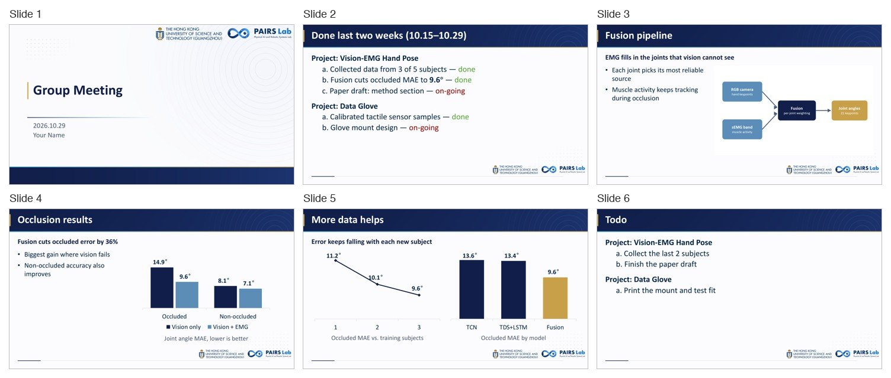

# PAIRS Lab Group Meeting Skill

A Claude Code skill that turns your progress notes, figures, demo videos and numbers into
**PAIRS Lab (HKUST-GZ) group-meeting slides** (组会 PPT) on the lab's own template. The actual
`.pptx` generation and QA go through Anthropic's **pptx skill**.

一个 Claude Code skill：把你两周的进展、结果图、demo 视频和实验数字，直接做成基于实验室模板的组会 PPT。
真正生成 .pptx 和质量检查交给 Anthropic 官方的 pptx skill。



## What it makes

| Slide | What goes on it |
|---|---|
| Cover | "Group Meeting", date, presenter — the template cover |
| Done last two weeks | Items grouped by project, lettered `a. b. c.`, status in green (**done**) or red (**on-going**) |
| Results | A one-line takeaway, up to 3 short bullets, and figures / embedded demo videos / native PowerPoint charts |
| Paper reading | Paper title, a key figure, 2–3 points, citation footnote |
| Todo | Next steps per project |

Every slide is cloned from the template, so the background, header band and HKUST(GZ) / PAIRS Lab
logos are always right. Figures are laid out automatically, videos play in PowerPoint, charts stay
editable, and long Done lists split across slides by themselves.

### House style

Set in `skills/pairs-group-meeting/config.json` → `style`; the builder enforces the font floor and
warns about the rest:

- **All English** — notes written in Chinese are translated.
- **Body text ≥ 22pt** — text is never shrunk below it; the slide gets cut or split instead.
- **Few words, key sentences** — a one-line takeaway plus ≤ 3 bullets of ≤ 14 words.
- **Show it** — every results slide has a figure, demo video or chart.

## Requirements

- [Claude Code](https://claude.com/claude-code)
- The **pptx skill** — built into Claude apps as `anthropic-skills:pptx`; in Claude Code you can also
  get it from Anthropic's skills marketplace:
  `/plugin marketplace add anthropics/skills`, then `/plugin install document-skills@anthropic-agent-skills`
- Python ≥ 3.10 with `pip install -r skills/pairs-group-meeting/requirements.txt`
  (python-pptx, lxml, defusedxml, Pillow, PyMuPDF)
- For visual QA: **Microsoft PowerPoint for Mac** (exact renders through AppleScript) or LibreOffice

## Install

**As a plugin** (in Claude Code):

```
/plugin marketplace add ezoiHY/pairs-group-meeting-skill
/plugin install pairs-group-meeting@pairs-lab
```

**Or as a personal skill**, which is easier to edit:

```bash
git clone https://github.com/ezoiHY/pairs-group-meeting-skill.git
ln -s "$PWD/pairs-group-meeting-skill/skills/pairs-group-meeting" ~/.claude/skills/pairs-group-meeting
```

Then set your name and output folder in `skills/pairs-group-meeting/config.json`, or let Claude ask
the first time:

```json
{
  "presenter": "Your Name",
  "output_root": "~/Documents/PairsLab"
}
```

Decks are written to `<output_root>/<YYMMDD>GroupMeeting/<YYMMDD>GroupMeeting.pptx`, next to the
`deck_spec.json` they were built from, so you can tweak the spec and rebuild.

## Use

Just ask Claude Code, in Chinese or English:

> 帮我做 11.12 组会的 PPT。这两周 Vision-EMG 采完了 3 个人的数据，融合模型遮挡下 MAE 从 14.9° 降到 9.6°，
> 论文 method 部分在写。结果图在 ~/figs/mae.png，demo 视频 ~/videos/occlusion.mp4。下两周采完剩下 2 人、写完初稿。

Claude collects what's missing, plans the slides, writes a deck spec, builds it, renders every slide
and checks it before handing you the `.pptx`.

You can also build a spec by hand:

```bash
python skills/pairs-group-meeting/scripts/build_deck.py examples/demo/spec.json
python skills/pairs-group-meeting/scripts/render.py build/demo/261029GroupMeeting.pptx
```

The spec format is documented in [`references/spec-format.md`](skills/pairs-group-meeting/references/spec-format.md);
[`examples/demo/spec.json`](examples/demo/spec.json) builds the deck shown above.

## Layout

```
.claude-plugin/              plugin + marketplace manifests
skills/pairs-group-meeting/
  SKILL.md                   workflow and house style Claude follows
  assets/template.pptx       the lab template
  scripts/build_deck.py      spec.json → .pptx (uses the pptx skill's add_slide/clean/validate)
  scripts/render.py          .pptx → slide PNGs + overview (PowerPoint or LibreOffice)
  references/                spec format, template geometry/colors/fonts
  config.json                presenter, output folder, house-style limits
examples/demo/               a demo spec with synthetic data
```

The template, its backgrounds and the HKUST(GZ) and PAIRS Lab logos belong to their owners.
