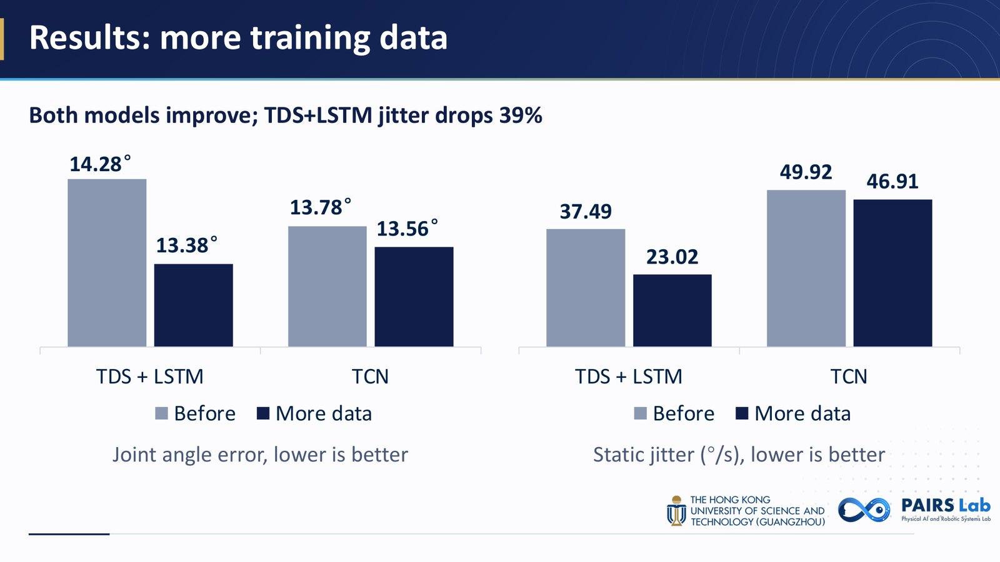
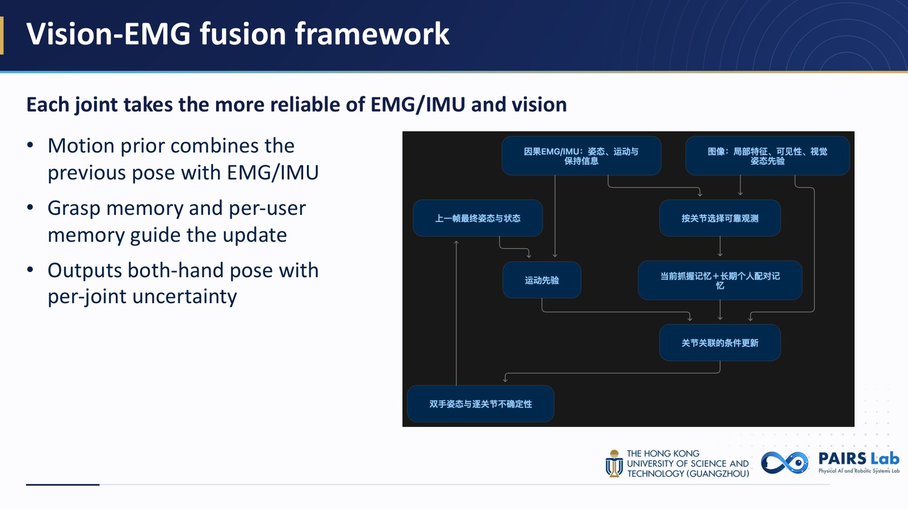
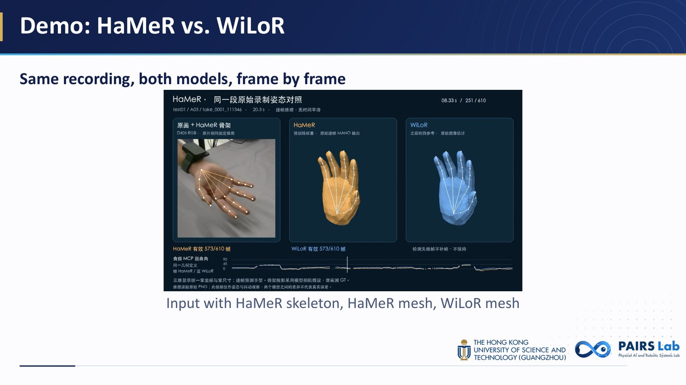
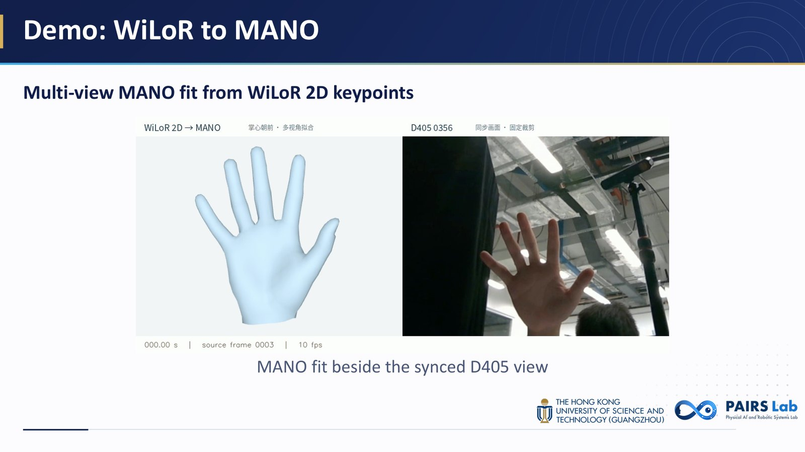
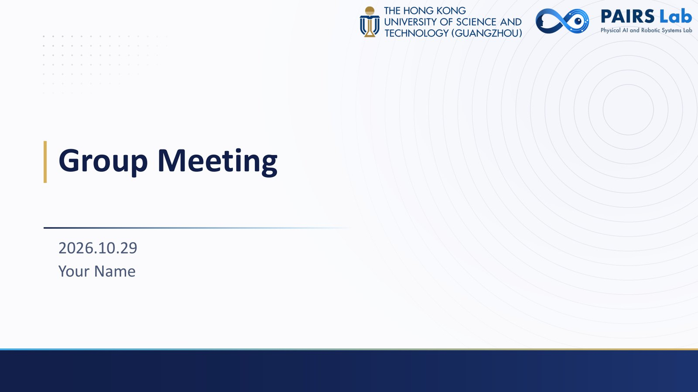
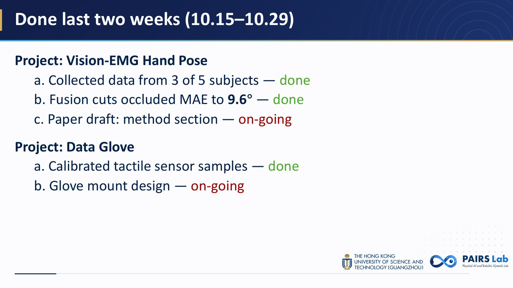
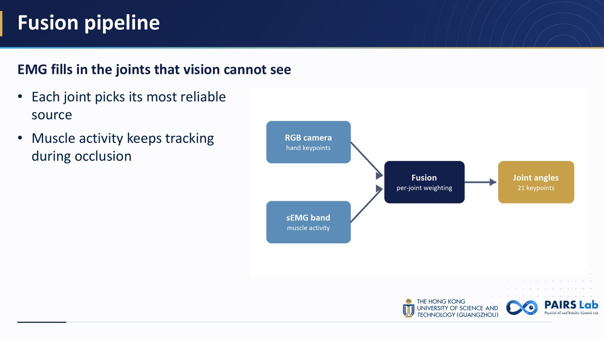
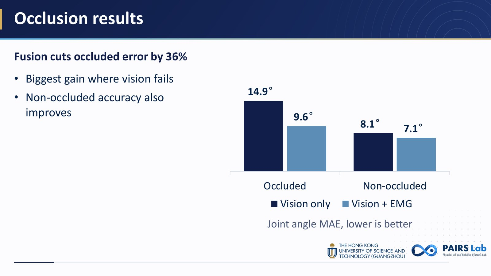
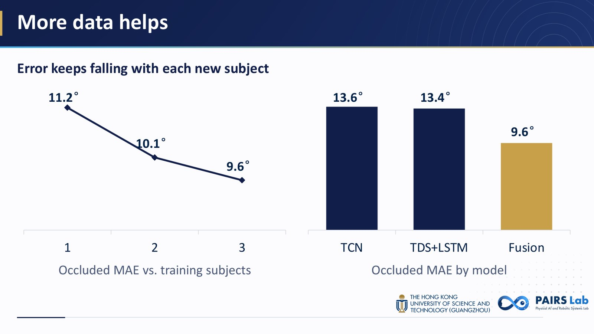
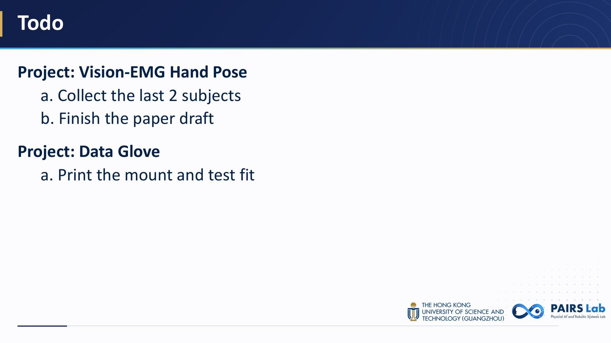

# PAIRS Lab Group Meeting Skill

A Claude Code skill that turns your progress notes, figures, demo videos and numbers into
**PAIRS Lab (HKUST-GZ) group-meeting slides** (组会 PPT) on the lab's own template. The actual
`.pptx` generation and QA go through Anthropic's **pptx skill**.

一个 Claude Code skill：把你两周的进展、结果图、demo 视频和实验数字，直接做成基于实验室模板的组会 PPT。
真正生成 .pptx 和质量检查交给 Anthropic 官方的 pptx skill。

## 用哪个版本 / Which version

仓库里有两个版本，做出来的 PPT 一样，spec 格式也一样。按你用的工具选一个：

| 你用的 | 装这个文件夹 | 区别 |
|---|---|---|
| **Claude Code** | [`skills/pairs-group-meeting/`](skills/pairs-group-meeting)（原版） | 生成和检查交给 Anthropic 的 pptx skill |
| **Codex** | [`codex/pairs-group-meeting/`](codex/pairs-group-meeting)（Codex 版） | 自带生成和检查的代码，不需要 pptx skill |

**Claude 用户用原版即可，Codex 用户用 Codex 版。** 不要把原版装进 Codex：原版依赖的 pptx skill
按其许可条款只能在 Anthropic 的服务里使用。

The two versions make the same slides from the same spec (the demo deck renders pixel-identical in
PowerPoint). Claude Code users install the original in `skills/`; Codex users install
`codex/pairs-group-meeting/`, which builds the file with python-pptx alone.

## Screenshots / 效果图

### With real research results / 真实实验结果

Slides built by the skill from real Vision-EMG hand-pose work: measured results, the fusion
framework diagram, and two demo videos. The videos are embedded and play in PowerPoint; here
you see their poster frames. Spec: [`examples/real/spec.json`](examples/real/spec.json)
(the media files it points to are not in this repo).

<table>
  <tr>
    <td width="50%"><br>
      <sub><b>Results as native charts</b> — before/after numbers, exact values labeled</sub></td>
    <td width="50%"><br>
      <sub><b>Method figure + key sentences</b> — the diagram explained in three short lines</sub></td>
  </tr>
  <tr>
    <td width="50%"><br>
      <sub><b>Demo video</b> — HaMeR vs. WiLoR on the same recording</sub></td>
    <td width="50%"><br>
      <sub><b>Demo video</b> — multi-view MANO fit beside the synced camera view</sub></td>
  </tr>
</table>

### Full demo deck / 完整示例

Rendered by PowerPoint from [`examples/demo/spec.json`](examples/demo/spec.json) (synthetic data).

<table>
  <tr>
    <td width="50%"><br>
      <sub><b>Cover</b> — date and presenter on the template cover</sub></td>
    <td width="50%"><br>
      <sub><b>Done last two weeks</b> — grouped by project, done / on-going in color</sub></td>
  </tr>
  <tr>
    <td width="50%"><br>
      <sub><b>Figure + key sentences</b> — a takeaway line, ≤ 3 bullets, the figure sized to fit</sub></td>
    <td width="50%"><br>
      <sub><b>Native chart</b> — values labeled, still editable in PowerPoint</sub></td>
  </tr>
  <tr>
    <td width="50%"><br>
      <sub><b>Two visuals</b> — laid out automatically, the best result in gold</sub></td>
    <td width="50%"><br>
      <sub><b>Todo</b> — next steps per project</sub></td>
  </tr>
</table>

## What it makes

| Slide | What goes on it |
|---|---|
| Cover | "Group Meeting", date, presenter — the template cover |
| Done last two weeks | Items grouped by project, lettered `a. b. c.`, status in green (**done**) or red (**on-going**) |
| Results | A one-line takeaway, up to 3 short bullets, and figures / embedded demo videos / native PowerPoint charts |
| Paper reading | Per paper: the authors' original pipeline figure with its problem and approach, then novelty and limitations side by side — all supplied by you, never guessed |
| Paper comparison | Per theme of 3–5 papers: a methods table, then a results table (best value bolded) — tables only, no figures. Example: [`examples/papers/spec.json`](examples/papers/spec.json) (synthetic) |
| Todo | Next steps per project |

Every slide is cloned from the template, so the background, header band and HKUST(GZ) / PAIRS Lab
logos are always right. Figures are laid out automatically, videos play in PowerPoint, charts stay
editable, and long Done lists split across slides by themselves.

### House style

Set in `skills/pairs-group-meeting/config.json` → `style`; the builder enforces the font floor and
warns about the rest:

- **All English** — notes written in Chinese are translated.
- **Body text ≥ 22pt** — text is never shrunk below it; the slide gets cut or split instead.
- **Few words, key sentences** — a one-line takeaway plus ≤ 3 bullets of ≤ 14 words.
- **Show it** — every results slide has a figure, demo video or chart (paper-comparison slides are the exception: tables only).

## Requirements

- [Claude Code](https://claude.com/claude-code) (original version) or [Codex](https://developers.openai.com/codex) (Codex version)
- Original version only: the **pptx skill** — built into Claude apps as `anthropic-skills:pptx`; in
  Claude Code you can also get it from Anthropic's skills marketplace:
  `/plugin marketplace add anthropics/skills`, then `/plugin install document-skills@anthropic-agent-skills`.
  The Codex version doesn't need it.
- Python ≥ 3.10 with `pip install -r skills/pairs-group-meeting/requirements.txt`
  (python-pptx, lxml, defusedxml, Pillow, PyMuPDF)
- For visual QA: **Microsoft PowerPoint for Mac** (exact renders through AppleScript) or LibreOffice

## Install

### Codex

```bash
git clone https://github.com/ezoiHY/pairs-group-meeting-skill.git
mkdir -p ~/.agents/skills
ln -s "$PWD/pairs-group-meeting-skill/codex/pairs-group-meeting" ~/.agents/skills/pairs-group-meeting
```

`~/.agents/skills/` is Codex's user skills folder. Codex also reads `~/.codex/skills/` (where
`$skill-installer` puts skills), so linking there works too. Set your name in
`codex/pairs-group-meeting/config.json`, or let Codex ask the first time.

### Claude Code

**As a plugin** (in Claude Code):

```
/plugin marketplace add ezoiHY/pairs-group-meeting-skill
/plugin install pairs-group-meeting@pairs-lab
```

**Or as a personal skill**, which is easier to edit:

```bash
git clone https://github.com/ezoiHY/pairs-group-meeting-skill.git
ln -s "$PWD/pairs-group-meeting-skill/skills/pairs-group-meeting" ~/.claude/skills/pairs-group-meeting
```

Then set your name and output folder in `skills/pairs-group-meeting/config.json`, or let Claude ask
the first time:

```json
{
  "presenter": "Your Name",
  "output_root": "~/Documents/PairsLab"
}
```

Decks are written to `<output_root>/<YYMMDD>GroupMeeting/<YYMMDD>GroupMeeting.pptx`, next to the
`deck_spec.json` they were built from, so you can tweak the spec and rebuild.

## Use

Just ask Claude Code or Codex, in Chinese or English (in Codex you can also call it by name,
`$pairs-group-meeting …`):

> 帮我做 11.12 组会的 PPT。这两周 Vision-EMG 采完了 3 个人的数据，融合模型遮挡下 MAE 从 14.9° 降到 9.6°，
> 论文 method 部分在写。结果图在 ~/figs/mae.png，demo 视频 ~/videos/occlusion.mp4。下两周采完剩下 2 人、写完初稿。

Claude collects what's missing, plans the slides, writes a deck spec, builds it, renders every slide
and checks it before handing you the `.pptx`.

You can also build a spec by hand:

```bash
python skills/pairs-group-meeting/scripts/build_deck.py examples/demo/spec.json
python skills/pairs-group-meeting/scripts/render.py build/demo/261029GroupMeeting.pptx
```

With the Codex version, use `codex/pairs-group-meeting/scripts/` instead of
`skills/pairs-group-meeting/scripts/`.

The spec format is documented in [`references/spec-format.md`](skills/pairs-group-meeting/references/spec-format.md);
[`examples/demo/spec.json`](examples/demo/spec.json) builds the deck shown above.

## 组会汇报怎么做

这一节说明：用这个 skill 做一次组会汇报，你要准备什么、PPT 怎么排、论文怎么讲。
PPT 本身是全英文的，你对 Claude 说中文、贴中文笔记都可以，它会翻译。
下面说的"Claude"，用 Codex 版时就是 Codex，做法完全一样。

### 1. 整体流程

1. 对 Claude Code 或 Codex 说一句话：会议日期、这两周做了什么、结果图和 demo 视频的路径（见上面 Use 里的例子）。
2. Claude 一次性问清缺的东西：哪些结果还没有图、论文还缺哪几项、上次的 Todo 哪些做完了。
3. 它写出 `deck_spec.json`，构建 `.pptx`，用 PowerPoint 渲染每一页并检查，然后交给你。
4. 想改的话，直接改 `deck_spec.json` 再重新构建：

   ```bash
   python skills/pairs-group-meeting/scripts/build_deck.py <output_root>/<YYMMDD>GroupMeeting/deck_spec.json
   ```

   用原版时，如果提示找不到 pptx skill，加上 `--pptx-skill <pptx skill 的目录>`。
   用 Codex 版时，把路径换成 `codex/pairs-group-meeting/scripts/build_deck.py`。

### 2. 一场组会的 PPT 怎么排

| 顺序 | 页 | 内容 |
|---|---|---|
| 1 | Cover | 日期和你的名字 |
| 2 | Done last two weeks | 按项目分组，每条标 done 或 on-going |
| 3 | Results | 一页一个结论，配图 / 图表 / demo 视频，数量按工作量定 |
| 4 | Paper reading | 可选。每篇论文 2 页 |
| 5 | Paper comparison | 可选。读了 2 篇以上才有，放在论文之后 |
| 6 | Todo | 下两周要做的事 |

一般 8–14 页，每页讲 1.5–2 分钟。

### 3. 你需要准备什么

| 部分 | 要给 Claude 的东西 |
|---|---|
| Done | 上次组会以来做了什么，按项目分组，哪些完成、哪些还在做。Claude 会读上一次 PPT 的 Todo，当作这次 Done 的候选 |
| Results | 每个结果的图、截图或 demo 视频，加一句你想让大家记住的结论。只有数字也行，会做成图表 |
| Todo | 下两周的计划，有截止日期就写上 |
| 论文 | 见下面两节 |

### 4. 讲一篇论文

每篇论文你要给齐五样东西，缺哪样 Claude 就问哪样，**不会替你补**：

1. **原版 pipeline 图**：论文自己的方法总览图（图片，或 PDF 加页码），不要自己重画
2. **要解决什么问题**（Problem）
3. **怎么解决的**（Approach）
4. **创新点**（Novelty）
5. **不足**（Limitations）：这是你自己的判断，不要让 Claude 替你写。想不出来就想想"它在什么情况下会失效"：要额外传感器、只测了一个数据集、需要逐人标定……

每篇论文生成 2 页：

- 第 1 页：pipeline 图，旁边两句 Problem 和 Approach
- 第 2 页：Novelty 和 Limitations 左右两栏，每栏最多 2 条

你口头讲的详细解释会放进这两页的 speaker notes，页面上只留每行不超过 14 个词的短句。

讲的时候的建议（来自常见的 journal club / reading group 做法）：

- 先讲问题，再顺着 pipeline 图从输入讲到输出，不要把论文的图一张张过一遍
- 创新点只讲和前人相比真正新的那一两点
- 以不足和你自己的看法收尾，最好给大家抛一个具体的问题

### 5. 对比几篇论文

读了 2 篇以上时，按**主题**分组，每组 3–5 篇，每组生成两页，**只有表格，没有图**：

1. **方法表**（先比方法）：每行一篇论文，第一列是论文名，后面只放能区分这几篇的维度，比如输入、核心想法、额外成本
2. **结果表**（再比结果）：每行一篇论文，数字放在同一个基准数据集上。表头写 ↓ 或 ↑，每列最好的值会自动加粗

注意：

- 表格下方的脚注要写清楚基准数据集和设置，以及数字是不是论文自己报告的（as reported）。设置不同的数字不要硬比，对不上的格子写 `—`
- 数字必须来自你，Claude 不会编
- 一组最多 5 篇、5 列，超过会警告，这时拆成两个主题，或者删掉区分度不大的列

### 6. 写 PPT 的规矩

- **全英文**：标题、要点、表格、图注都是英文，专有名词保持原样（MAE、TCN、HaMeR）
- **正文不小于 22pt**：放不下就删字或拆页，不缩字号
- **少字**：一页一个结论，一行副标题讲结论，最多 3 条要点，每条不超过 14 个词
- **结果页要有图**：图、图表或 demo 视频；论文对比页是例外，只放表格
- **细节放 notes**：想多讲的话写在 speaker notes 里，不要塞进页面

### 7. 构建时的 WARNING

构建结束会打印 WARNING，每一条都要处理，Claude 会照着改：缺图缺字段会回来问你，要点太长会让你缩短或拆页，
论文对比超过 5 篇会建议拆主题。完整的警告和处理办法见 [`SKILL.md`](skills/pairs-group-meeting/SKILL.md)。

### 8. 一个完整的例子

> 帮我做 11.12 组会的 PPT。这两周 Vision-EMG 采完了 3 个人的数据，融合模型遮挡下 MAE 从 14.9° 降到 9.6°，
> 结果图在 ~/figs/mae.png。读了两篇论文：
> A（CVPR 2025）要解决遮挡下手部姿态估计失效，用上一帧姿态做先验，创新是按关节可见性给先验加权，不足是长时间遮挡会漂移，pipeline 图在 ~/papers/a_fig2.png；
> B（ICRA 2025）用 EMG 和视觉融合，创新是每个关节单独学融合权重，不足是每个人都要标定，pipeline 图在 ~/papers/b_fig2.png。
> 两篇一起比一下，MAE 和遮挡下 MAE 的数字在 ~/papers/results.md。下两周采完剩下 2 人。

示例 spec 见 [`examples/papers/spec.json`](examples/papers/spec.json)（数据是虚构的）。

## Layout

```
.claude-plugin/              plugin + marketplace manifests (Claude Code)
skills/pairs-group-meeting/  the original version, for Claude Code
  SKILL.md                   workflow and house style Claude follows
  assets/template.pptx       the lab template
  scripts/build_deck.py      spec.json → .pptx
  scripts/deck_structure.py  clones template slides with the pptx skill's add_slide/clean/validate
  scripts/render.py          .pptx → slide PNGs + overview (PowerPoint or LibreOffice)
  references/                spec format, template geometry/colors/fonts
  config.json                presenter, output folder, house-style limits
codex/pairs-group-meeting/   the Codex version
  SKILL.md                   generated from the original by tools/sync_codex.py
  scripts/deck_structure.py  clones template slides with python-pptx alone
  scripts/slide_text.py      prints a deck's text, slide by slide
  …                          everything else is a copy of the original's
tools/sync_codex.py          brings the Codex version up to date with the original
examples/demo/               a demo spec with synthetic data
examples/papers/             paper-reading and paper-comparison slides, synthetic data
```

**Changing the skill:** edit the original in `skills/pairs-group-meeting/`, then run
`python tools/sync_codex.py` to update the Codex version. `--check` exits non-zero if the Codex
version is out of date. Only `deck_structure.py`, `slide_text.py` and `config.json` are edited by
hand in `codex/`.

The template, its backgrounds and the HKUST(GZ) and PAIRS Lab logos belong to their owners.
